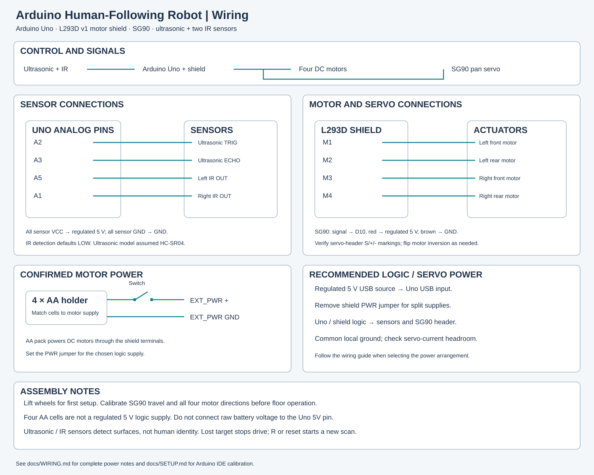
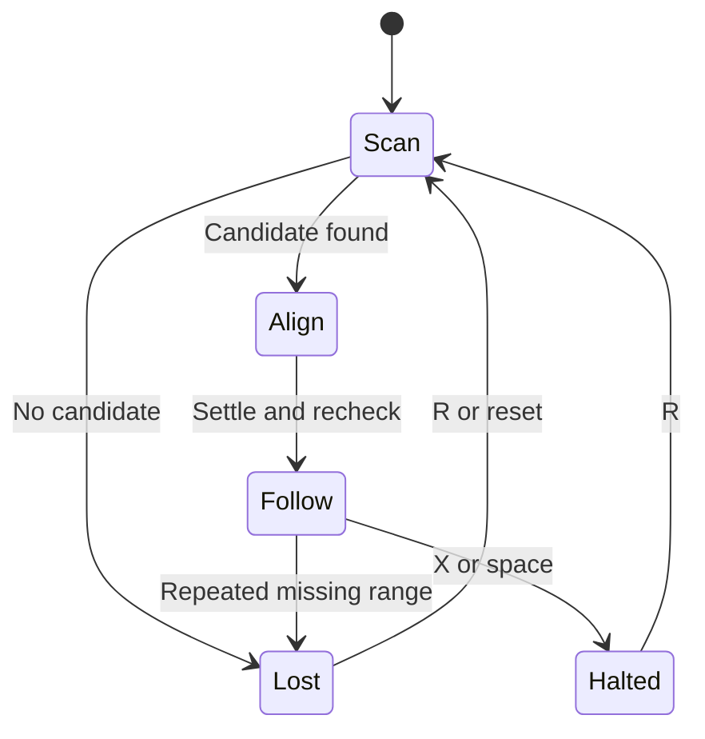

# Arduino Human-Following Robot

**An Arduino Uno robot that scans with an ultrasonic sensor, steers using two IR sensors and follows a nearby target at a configurable distance.**

The build uses a four-wheel chassis, an L293D motor shield and an SG90 pan servo. A switched four-AA battery holder supplies the shield's motor-power terminals. When the target is lost, the robot stops.

Built by **Ibrahim Mallick**. The project was inspired by [vermaPrateek10/Human-Following-Robot](https://github.com/vermaPrateek10/Human-Following-Robot). See [credits](CREDITS.md) for the source relationship.

## Features

- Nominal 180° startup scan with distance readings at each angle.
- Short, configurable chassis alignment towards the selected candidate.
- Ultrasonic gap control with median filtering and a stop band.
- Left/right IR sensing for differential steering.
- Four DC motor outputs through an L293D/AFMotor-compatible shield.
- Immediate stop command and a latched lost-target state.
- Arduino IDE sketch, editable configuration and wiring documentation.

The name describes the intended demonstration. Ultrasonic and reflective IR sensors detect nearby surfaces; they do not recognize a person or maintain identity among multiple people.

## Hardware

| Component | Quantity | Notes |
| --- | --- | --- |
| Arduino Uno | 1 | ATmega328P / Uno R3 target |
| L293D motor shield | 1 | AFMotor-compatible v1 style; sits on Uno |
| Geared DC motors and wheels | 4 | One motor per M1–M4 channel; verify current ratings |
| Ultrasonic module | 1 | HC-SR04-compatible |
| Reflective IR obstacle modules | 2 | Left/right, digital outputs |
| SG90 servo | 1 | Confirmed pan actuator |
| Chassis and sensor bracket | 1 set | Four-wheel arrangement |
| Four-AA holder and switch | 1 | Confirmed motor battery arrangement |
| Jumper wires | As required | Sensor and shield connections |
| Regulated logic-power source | As needed | See power section |

## Wiring

| Item | Pin / terminal |
| --- | --- |
| Ultrasonic TRIG | A2 |
| Ultrasonic ECHO | A3 |
| Left IR OUT | A5 |
| Right IR OUT | A1 |
| SG90 signal | D10 servo header; verify board label |
| Sensor and servo power | Regulated 5 V and common GND |
| Left motors | M1 and M2 |
| Right motors | M3 and M4 |
| Four-AA positive | Switch → shield EXT_PWR positive |
| Four-AA negative | Shield EXT_PWR GND |

The motor grouping follows the firmware mapping. Flip motor inversion flags or swap motor leads during calibration if needed. See [WIRING.md](docs/WIRING.md) before powering it.

## How it works

1. **Scan:** chassis stays stopped while the SG90 moves across its configured travel. The code measures range at each position and selects the nearest valid candidate within the acquisition limits.
2. **Align:** a short, capped turn points the chassis approximately towards the candidate. This is an open-loop calibration, not measured heading control.
3. **Follow:** the servo faces forward. Ultrasonic range determines forward motion; IR outputs adjust left/right wheel speeds.
4. **Maintain gap:** default goal is 25 cm. A 5 cm upper deadband prevents repeated corrections near the stop position. The robot stops when too close and does not reverse automatically.
5. **Lost target:** an invalid/out-of-range reading stops drive immediately. Three consecutive misses latch the lost state; send `R` or reset to scan again.

The 25 cm gap, PWM values, sweep steps and timing are configurable defaults. This is a proportional distance-based approach/stop controller; it is not a full PID or position-estimation system.

## Arduino IDE setup

1. Install **Arduino IDE** and select **Arduino Uno**.
2. Install **Adafruit Motor Shield library** for the **v1 L293D shield** (`AFMotor.h`), plus **Servo** by Arduino if not already available. The v2 I²C motor-shield library is not interchangeable.
3. Open `firmware/HumanFollower/HumanFollower.ino`. Keep `Config.h` and `Control.h` in that folder.
4. Click **Verify**, select the Uno's USB port, then **Upload**.
5. First run with wheels lifted. Check motor directions, servo travel, IR polarity and distance readings before placing it on the floor.

Full guide: [SETUP.md](docs/SETUP.md).

## Controls and tuning

Serial Monitor: **115200 baud**.

| Input | Action |
| --- | --- |
| `R` | Stop and start a fresh scan |
| `X` or space | Stop and latch halted state |
| Reset button | Restart startup acquisition |

Tune `Config.h`: following gap, maximum acquisition range, IR polarity, PWM limits, individual motor inversion, servo centre/travel and alignment timing. Adjust the IR modules' potentiometers for the intended surface and lighting.

## Power

The motor supply uses **four AA cells connected to the shield through a switch**. Configure the shield power jumper for the selected logic-power arrangement.

Four alkaline AAs are nominally 6 V; four NiMH cells are nominally 4.8 V. Do not assume either provides a stable regulated 5 V rail for the Uno/servo or sufficient Uno VIN headroom. Motor-driver voltage drop and battery sag also reduce wheel torque.

For a repeatable setup, use the AA pack at **EXT_PWR**, remove the shield's power jumper, and supply the Uno through a regulated 5 V USB source such as a power bank. To reproduce a one-pack arrangement, design a suitable regulated logic-power path and verify the exact shield's jumper routing first. Do not connect raw battery voltage to the Uno 5V pin or parallel USB power with an unverified jumper arrangement.

Adafruit's [v1 shield power guide](https://learn.adafruit.com/adafruit-motor-shield/power-requirements) explains split supplies and jumpers. [WIRING.md](docs/WIRING.md) shows the recommended reproduction arrangement separately from the confirmed build record.

## Files

| Path | Purpose |
| --- | --- |
| `firmware/HumanFollower/` | Arduino sketch and configuration |
| `docs/wiring.svg`, `docs/wiring.png` | Editable/viewable diagram |
| `docs/WIRING.md` | Connections and power details |
| `docs/SETUP.md` | Arduino IDE and calibration |
| `docs/TESTING.md` | Checks, assumptions and integration procedure |
| `docs/PORTFOLIO.md` | Concise project description |
| `docs/PUBLISH.md` | Drag-and-drop GitHub steps |
| `CREDITS.md` | Inspiration and dependency credits |
| `tests/control_test.cpp` | Native decision-logic checks |

## Usage notes

Reflective IR performance depends on distance, surface reflectivity and ambient light. Ultrasound may follow a wall, chair or another object. The scan chooses a nearby candidate rather than recognizing a human. There are no encoders, rear obstacle sensors or heading feedback, so steering and alignment require calibration. SG90 endpoint travel and motor current must be checked against the actual hardware.
